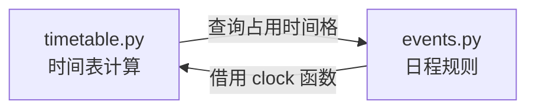
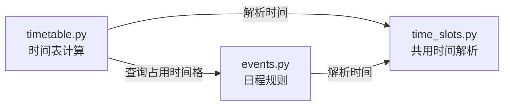

# 第一阶段重构：时间模块的循环依赖

本页说明 `refactor/01-time-dependency` 分支中已经完成的代码结构调整。它解决的是模块之间互相依赖的问题，**不是已经证实的时间计算 Bug**；用户看到的功能、时间计算结果和原有错误提示应保持不变。

## 循环依赖的通俗解释

### 一、修改前：为什么会形成循环依赖？

| 谁找谁？ | 为什么？ |
| --- | --- |
| `timetable.py → events.py` | 查询哪些时间格已经被日程占用。 |
| `events.py → timetable.py` | 在移动日程时，借用时间转换函数 `clock()`。 |

原来 `timetable.py` 为了安排时间表，需要 `events.py` 提供日程占用信息；而 `events.py` 在移动日程时，又要向 `timetable.py` 借用时间转换函数，因此形成循环依赖。修改前的具体代码是 `timetable.py` 导入 `event_cells`，以及 `events.py` 的 `move_occurrence()` 内局部导入 `timetable.clock`。局部导入并不表示程序已发生启动错误，但两个模块因此难以独立使用和维护。

### 二、修改后：如何解决？

| 谁找谁？ | 为什么？ |
| --- | --- |
| `timetable.py → events.py` | 查询日程占用情况；这条依赖保留。 |
| `events.py → time_slots.py` | 使用共用时间解析功能。 |
| `timetable.py → time_slots.py` | 使用共用时间解析功能。 |

新增 `time_slots.py`，将共用的时间解析逻辑独立出来。`events.py` 不再反向导入 `timetable.py`，因此解除循环依赖。两个原有的 `clock()` 函数仍可使用，并保留各自的错误提示；移动日程时也继续使用原先的时间表错误提示。

### 三、结合 Planwise 功能举例

用户把私人时间从 **09:00 移到 09:30**。`events.py` 处理这次日程移动；共用时间解析功能把 `09:30` 转换成从午夜起算的 **570 分钟**；`timetable.py` 负责时间表相关计算，例如判断哪些时间格已被事项占用。重构只改变这段代码放在哪个模块及模块如何导入，**不改变原有功能**。

### 四、一句话总结

原来 `timetable` 找 `events` 查询日程占用，而 `events` 又找 `timetable` 转换时间，导致互相依赖。现在新增 `time_slots` 专门负责时间转换，两个文件都可以使用它，循环依赖就解决了。

## 本次文档核对与既有验证记录

- 当前源码：`timetable.py` 导入 `events.event_cells` 和 `time_slots.parse_clock`；`events.py` 导入 `time_slots.parse_clock`，没有导入 `timetable.py`。
- 上一轮重构完成时记录：Python 测试 **104/104 通过**，Node 测试 **10/10 通过**，两条 JavaScript 语法检查通过。本次仅撰写文档，**未重新运行测试**。
